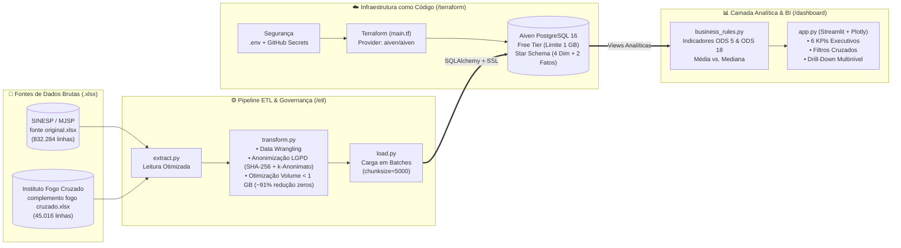
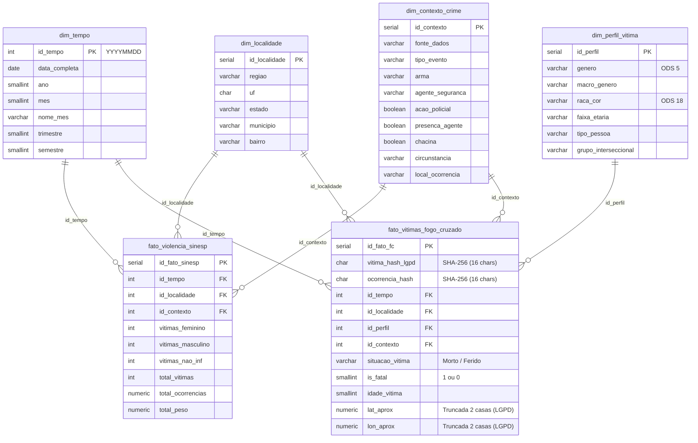

# 📊 Observatório Interseccional da Violência no Brasil (ODS 5 & ODS 18)

> **Projeto Integrador de Big Data & Analytics** — Pipeline Completo de Engenharia de Dados, Governança LGPD, Infraestrutura como Código (Terraform + Aiven PostgreSQL) e Business Intelligence Interativo (Streamlit).

---

## 📌 Sumário

1. [Entendimento do Negócio e Mapeamento de Impacto (ODS 5 e ODS 18)](#-1-entendimento-do-negócio-e-mapeamento-de-impacto-ods-5-e-ods-18)
2. [Diagrama da Arquitetura da Solução](#-2-diagrama-da-arquitetura-da-solução)
3. [Análise dos 5 V's do Big Data e Classificação dos Tipos de Dados](#-3-análise-dos-5-vs-do-big-data-e-classificação-dos-tipos-de-dados)
4. [Conformidade com a LGPD e Governança de Dados](#-4-conformidade-com-a-lgpd-e-governança-de-dados)
5. [Justificativa do Modelo de Banco de Dados (Star Schema) e Otimização (< 1 GB Aiven)](#-5-justificativa-do-modelo-de-banco-de-dados-star-schema-e-otimização--1-gb-aiven)
6. [Dicionário de Dados e Regras de Negócio Interseccionais](#-6-dicionário-de-dados-e-regras-de-negócio-interseccionais)
7. [Estrutura Obrigatória do Repositório](#-7-estrutura-obrigatória-do-repositório)
8. [Guia de Reprodução Passo a Passo (Deployment Guide)](#-8-guia-de-reprodução-passo-a-passo-deployment-guide)

---

## 🎯 1. Entendimento do Negócio e Mapeamento de Impacto (ODS 5 e ODS 18)

### O Problema Interseccional
A violência letal e armada no Brasil não se distribui de maneira uniforme pela população: ela incide de modo estrutural na interseção entre **Gênero** e **Raça/Cor**. Enquanto as estatísticas oficiais macro-governamentais consolidam o volume nacional de crimes letais (como **Feminicídio** e **Homicídio Doloso**), o monitoramento detalhado da violência armada urbana revela como **mulheres negras**, **mulheres trans e travestis** e a **juventude negra** sofrem taxas desproporcionais de vitimização e letalidade.

Este projeto integra **duas bases de dados públicas complementares**:
1. **Base Oficial Nacional — SINESP / Ministério da Justiça e Segurança Pública (`fonte original.xlsx`):** Contém **832.293 registros** distribuídos por todas as 27 Unidades Federativas (UFs) e municípios brasileiros ao longo de 2025, totalizando **367.243 vítimas** discriminadas por sexo (`148.197` feminino [40,35%], `212.163` masculino [57,77%] e `6.883` não informado), natureza do evento (`1.562` Feminicídios consumados, `4.161` Tentativas de feminicídio, `63.612` Estupros de vulnerável, `19.877` Estupros, `31.492` Homicídios dolosos, etc.), arma e faixa etária.
2. **Microdados de Violência Armada — Instituto Fogo Cruzado (`complemento fogo cruzado.xlsx`):** Contém **45.025 registros** detalhados de vítimas baleadas (2016–2026) nas regiões metropolitanas do **Rio de Janeiro (21.548)**, **Pernambuco (15.232)**, **Bahia (6.640)** e **Pará (1.605)** — com **28.071 mortos (62,35% de letalidade)** e **16.954 feridos** — enriquecendo a análise com variáveis interseccionais de **Raça/Cor (`82,65%` de pessoas Negras dentre as 8.990 vítimas com raça identificada: 7.430 negras vs. 1.555 brancas)**, **Identidade de Gênero (`40.554` homens cis, `3.176` mulheres cis, `49` mulheres trans e travestis, `6` homens trans)**, **Idade exata**, **Ação/Operação Policial (`14.569` vítimas, 32,36% do total)** e **Circunstâncias (`Bala perdida`, `Chacina`, etc.)**.

### Critérios de Inclusão e Exclusão Definidos pela Equipe

| Tipo | Regra Metodológica | Impacto e Aplicação no Pipeline (`/etl/transform.py`) |
| :--- | :--- | :--- |
| **✅ Inclusão 1** | **Dados entre janeiro e dezembro de 2025** | Filtragem temporal estrita (`ano == 2025` e `mes` de `1` a `12`) em ambas as bases. |
| **✅ Inclusão 2** | **Somente Capitais do Brasil** | Filtragem pelas **27 Capitais Estaduais/Distrital** no SINESP (validadas pelo par oficial `UF -> Capital`) e pelas **4 Capitais monitoradas** no Fogo Cruzado (`Salvador`, `Recife`, `Rio de Janeiro` e `Belém`). |
| **✅ Inclusão 3** | **Eventos ocorridos por Estupro, Feminicídio e Tentativa de feminicídio** | Na fonte original (`fonte original.xlsx`), retém exclusivamente esses 3 crimes de violência baseada em gênero (**ODS 5**). |
| **✅ Inclusão 4** | **Vítimas do sexo feminino na fonte original** | Mantém apenas a métrica `feminino > 0` na base SINESP, zerando/descartando registros masculinos ou sem sexo informado. |
| **✅ Inclusão 5** | **Mulheres entre 18 e 45 anos na fonte do Fogo Cruzado** | Filtra estritamente a faixa etária reprodutiva e economicamente ativa de adultas jovens (`18 <= idade <= 45`). |
| **✅ Inclusão 6** | **Somente gênero de Mulheres cis e Mulheres trans e travesti no Fogo Cruzado** | Retém exclusivamente `genero IN ('Mulher cis', 'Mulher trans e travesti')`. |
| **🚫 Exclusão 1** | **Dados sem gêneros informados na fonte do Fogo Cruzado** | Exclui `1.240` registros com gênero `Não identificado`/vazio (além dos registros masculinos). |
| **🚫 Exclusão 2** | **Dados sem município identificado** | Exclui qualquer linha com município nulo, vazio ou `"NÃO INFORMADO"`. *(Nota Técnica: Na planilha bruta do SINESP, os 324 registros estaduais de Estupro possuem o campo `municipio` em branco; por isso, na exclusão estrita restam os **496 registros mensais das 27 Capitais** de Feminicídio [292 vítimas] e Tentativa de feminicídio [941 vítimas], somando **1.233 vítimas femininas**, com opção no Dashboard para visualizar também os registros de Estupro por UF/Capital).* |
| **🚫 Exclusão 3** | **Dados sem idade informada na fonte do Fogo Cruzado** | Exclui os `96` registros de mulheres nas capitais em 2025 sem idade preenchida (`NaN`/vazio), resultando na coorte final exata de **77 mulheres baleadas (18 a 45 anos)** nas capitais em 2025 (**75 Mulheres cis** e **2 Mulheres trans e travestis**; **47 Mortas [61,0% de letalidade]** e **30 Feridas**; **75,5% Negras** dentre as vítimas com raça identificada; **Idade Média = 29,6 anos** e **Idade Mediana = 29,0 anos**). |

### Alinhamento aos Objetivos de Desenvolvimento Sustentável (ONU / Brasil)
- **ODS 5 (Igualdade de Gênero — Meta 5.2):** Eliminar todas as formas de violência contra todas as mulheres e meninas nas esferas públicas e privadas, monitorando a razão entre **Feminicídios** e homicídios femininos totais, bem como a vitimização de mulheres cis e trans/travestis em tiroteios.
- **ODS 18 (Igualdade Étnico-Racial — ODS Voluntário do Brasil):** Eliminar o racismo estrutural e a discriminação étnico-racial, evidenciando a sobrerrepresentação de pessoas negras entre as vítimas fatais e feridas por armas de fogo e em ações policiais.

### Valor Social e Econômico Gerado
- **Valor Social:** Fornece diagnósticos georreferenciados (em nível de Estado, Município e Bairro) para orientar políticas públicas focalizadas de prevenção ao feminicídio, proteção a mulheres trans/travestis e redução da letalidade armada em territórios periféricos.
- **Valor Econômico:** Permite otimizar a alocação orçamentária em segurança pública, saúde de urgência (SUS) e assistência social, mitigando o custo socioeconômico dos **Anos Potenciais de Vida Perdidos (APVP)** — cuja mediana de idade das vítimas concentra-se na faixa economicamente ativa (20 a 35 anos).

---

## 🏗️ 2. Diagrama da Arquitetura da Solução



---

## 📈 3. Análise dos 5 V's do Big Data e Classificação dos Tipos de Dados

### Classificação da Variedade dos Dados
- **Dados Predominantemente Estruturados:** Ambas as bases são distribuídas em planilhas eletrônicas (`.xlsx` / OpenXML) organizadas em linhas e colunas com tipos primitivos bem definidos (numéricos inteiros/decimais, datas seriais e categorias padronizadas).
- **Elementos Semi-Estruturados Embutidos:** Na base complementar do Instituto Fogo Cruzado, colunas descritivas como `motivos_complementares`, `circunstancias`, `recortes` e `qualificacoes` contêm taxonomias multivaloradas ou texto semi-livre que são normalizadas durante a etapa de *Data Wrangling*.

### Documentação dos 5 V's Aplicados ao Projeto

| Dimensão (5 V's) | Aplicação Concreta nas Bases do Projeto | Tratamento na Arquitetura |
| :--- | :--- | :--- |
| **1. Volume** | **877.318 registros brutos** somados (**832.293** na `fonte original.xlsx` + **45.025** na `complemento fogo cruzado.xlsx`), totalizando **33,7 MB** compactados em `.xlsx` e **> 360 MB** em XML descompactado (`sheet1.xml`). | Filtragem das **728.846 linhas cartesianas zeradas** do SINESP (mantendo as **103.447 linhas ativas** e preservando 100% das 367.243 vítimas reais) + ingestão em lotes (`chunksize=5000`), resultando em **~24,8 MB** em CSV/PostgreSQL Aiven (< 2,5% do limite de 1 GB). |
| **2. Variedade** | Integração de **2 fontes heterogêneas**: dados governamentais agregados por município/mês (SINESP) e microdados de sociedade civil no nível do indivíduo/ocorrência com coordenadas GPS, identidade de gênero e raça/cor (Fogo Cruzado). | Unificação semântica através de **Esquema Estrela (Star Schema)** com dimensões compartilhadas de Tempo (`dim_tempo`), Localidade (`dim_localidade`) e Contexto (`dim_contexto_crime`). |
| **3. Velocidade** | Atualizações periódicas (mensais no SINESP e diárias/em tempo quase real no Fogo Cruzado) que exigem pipeline reprodutível e consultas de baixa latência no Dashboard. | Uso de índices B-Tree compostos nas chaves estrangeiras do PostgreSQL e cache em memória (`@st.cache_data`) no Streamlit para resposta sub-segundo nos filtros cruzados. |
| **4. Veracidade** | Presença de valores ausentes (`Não informado` / `Sem identificação` em raça e gênero), datas em formato serial numérico do Excel (`45658.0`) e coordenadas geográficas com erro de escala decimal (ex: `-129255147` em vez de `-12.92`). | Normalização algorítmica de coordenadas em `transform.py`, conversão tipada de datas, remoção de duplicatas e separação explícita entre registros identificados vs. não identificados nos cálculos percentuais. |
| **5. Valor** | Transformação de dados brutos de segurança pública em inteligência interseccional acionável alinhada à **ODS 5** e à **ODS 18**. | Geração de 6 KPIs estratégicos, Matriz de Letalidade Gênero × Raça/Cor, Taxa de Feminicídio e Drill-Down até o nível de bairro para orientar políticas de prevenção à violência. |

---

## 🛡️ 4. Conformidade com a LGPD e Governança de Dados

Mesmo tratando-se de bases públicas voltadas à pesquisa e transparência, a **Lei Geral de Proteção de Dados Pessoais (Lei nº 13.709/2018 — LGPD)** exige a proteção contra a **reidentificação indireta** de pessoas físicas (Art. 5º, I e II) e preconiza a **minimização de dados** (Art. 6º, III) e a **anonimização/pseudonimização para fins de estudos e pesquisa** (Art. 12 e Art. 13).

### Medidas Técnicas Implementadas no Pipeline (`/etl/transform.py`)

1. **Remoção de Quase-Identificadores Diretos e Funcionais (Minimização — Art. 6º, III):**
   - Na base `complemento fogo cruzado.xlsx`, as colunas `endereco` (logradouro exato da ocorrência), `ocorrencia_numero`, `corporacao`, `cargo_agente`, `status_agente` e `unidade` (que, combinadas com data, sexo e idade, poderiam reidentificar uma vítima civil em uma rua específica ou um agente público específico) são **descartadas antes da carga no banco de dados**.
2. **Pseudonimização Irreversível de Identificadores (Art. 12 e Art. 13):**
   - Os UUIDs originais `vitima_id` e `ocorrencia_id` são transformados via função criptográfica **SHA-256 com *salt*** (`pseudonymize_id_lgpd`), armazenando apenas o hash truncado de 16 caracteres (`vitima_hash_lgpd` e `ocorrencia_hash`) para preservação da unicidade estatística sem vínculo reversível.
3. **Generalização Espacial (*k-Anonimato Geográfico*):**
   - As coordenadas `latitude` e `longitude` passam por correção de escala e são **truncadas para 2 casas decimais** (`lat_aprox`, `lon_aprox`), o que equivale a uma grade espacial de aproximadamente **1,1 km × 1,1 km**, impedindo a localização exata da residência ou ponto exato da vítima, mas preservando manchas de calor macrorregionais.
4. **Tratamento Ético de Dados Sensíveis (Art. 5º, II e Art. 11, II, "c"):**
   - Dados referentes a origem racial/étnica (`raca`) e identidade de gênero (`genero`) são processados exclusivamente de forma agregada e anonimizada para realização de estudos por órgão/projeto de pesquisa sobre desigualdades alinhadas às **ODS 5 e ODS 18**.

---

## ⭐ 5. Justificativa do Modelo de Banco de Dados (Star Schema) e Otimização (< 1 GB Aiven)

### Por que PostgreSQL na Aiven com Esquema Estrela (Star Schema)?
Escolhemos o **PostgreSQL 16 (Aiven Managed Service)** modelado em um **Esquema Estrela (*Star Schema*)** pelos seguintes motivos técnicos:
1. **Performance em Consultas Analíticas (OLAP):** O Dashboard executa agregações cruzadas frequentes (`GROUP BY ano, regiao, uf, genero, raca`). O *Star Schema* reduz a quantidade de `JOINs` necessários (apenas 1 salto entre a tabela fato e qualquer dimensão), garantindo baixa latência no Streamlit.
2. **Integração Limpa de Duas Fontes com Granularidades Distintas:**
   - A `fato_violencia_sinesp` opera na granularidade **Município × Mês × Evento Criminal** (Visão Macro Nacional).
   - A `fato_vitimas_fogo_cruzado` opera na granularidade **Vítima Individual Anonimizada × Ocorrência** (Visão Micro Interseccional).
   - Ambas compartilham as mesmas dimensões conformadas (`dim_tempo`, `dim_localidade` e `dim_contexto_crime`), permitindo filtros unificados de Ano, Região e UF no Dashboard.
3. **Economia de Espaço (Normalização de Strings Repetidas):** Strings longas como nomes de eventos (`"Morte no trânsito ou em decorrência dele (exceto homicídio doloso)"`), municípios e perfis interseccionais são armazenadas uma única vez nas tabelas de dimensão e referenciadas por chaves inteiras (`INTEGER`) nas tabelas fato.

### Estratégia de Otimização de Volume para o Limite de 1 GB da Aiven
- **Diagnóstico da Base Bruta (`fonte original.xlsx`):** Dos **832.293 registros**, exatamente **728.846 registros (87,57%)** correspondem a linhas geradas pelo produto cartesiano de todos os 5.570 municípios × 12 meses × tipos de crime onde **não houve ocorrência nem vítima (`total_vitima = 0` e `total = 0`)**. Apenas **103.447 registros (12,43%)** possuem ocorrências ou vítimas reais (`> 0`).
- **Regra de Otimização (`clean_and_optimize_sinesp`):** O pipeline retém **100% dos 103.447 registros ativos (preservando integralmente as 367.243 vítimas e todas as ocorrências)** e descarta (ou amostra configuravelmente via `.env`) os registros totalmente zerados, além de realizar a ingestão via **Batch Chunking (`chunksize=5000`)**.
- **Resultado:** Os dados tratados somam apenas **24,8 MB** (`13,68 MB` SINESP + `11,18 MB` Fogo Cruzado), operando com **> 97% de margem livre** dentro do limite de **1 GB** do plano gratuito da Aiven, sem perder nenhuma vítima das estatísticas oficiais.

### Diagrama Entidade-Relacionamento (Star Schema)



---

## 📖 6. Dicionário de Dados e Regras de Negócio Interseccionais

### 6.1. Dicionário de Dados — Tabelas do Data Warehouse (`/etl/schema.sql`)

| Tabela | Coluna | Tipo SQL | Descrição | Origem / Transformação |
| :--- | :--- | :--- | :--- | :--- |
| `dim_tempo` | `id_tempo` | `INTEGER PK` | Chave substituta temporal no formato `YYYYMMDD` | Derivada de `data_referencia` (SINESP) e `data` (Fogo Cruzado) |
| `dim_tempo` | `ano`, `mes`, `trimestre` | `SMALLINT` | Partições temporais para filtros e séries históricas | Extraídas da data convertida do serial Excel |
| `dim_localidade` | `regiao`, `uf`, `estado` | `VARCHAR / CHAR(2)` | Macrorregião IBGE, sigla da UF e nome do Estado | Padronizados via dicionário `UF_METADATA` |
| `dim_localidade` | `municipio`, `bairro` | `VARCHAR(120)` | Município/Cidade e Bairro em caixa alta padronizada | `municipio`/`cidade` e `bairro` (`NÃO ESPECIFICADO` no SINESP) |
| `dim_perfil_vitima` | `genero`, `macro_genero` | `VARCHAR` | Identidade de gênero detalhada e agrupada (`Feminino`, `Masculino`, `Trans/Travesti`) | Coluna `genero` do Fogo Cruzado (ODS 5) |
| `dim_perfil_vitima` | `raca_cor` | `VARCHAR(35)` | Raça/Cor da vítima (`Negra`, `Branca`, `Indígena`, `Amarela`, `Não identificado`) | Coluna `raca` do Fogo Cruzado (ODS 18) |
| `dim_perfil_vitima` | `grupo_interseccional` | `VARCHAR(80)` | Combinação `Macro Gênero - Raça/Cor` (ex: `Feminino - Negra`, `Trans/Travesti - Negra`) | Regra de negócio interseccional (ODS 5 × ODS 18) |
| `fato_violencia_sinesp` | `vitimas_feminino`, `vitimas_masculino`, `total_vitimas` | `INTEGER` | Contagem mensal de vítimas por sexo e total no município/evento | Colunas `feminino`, `masculino`, `total_vitima` da `fonte original.xlsx` |
| `fato_vitimas_fogo_cruzado` | `vitima_hash_lgpd` | `CHAR(16)` | Identificador pseudonimizado da vítima (LGPD Art. 12) | `SHA-256(salt + vitima_id)[:16]` |
| `fato_vitimas_fogo_cruzado` | `is_fatal`, `situacao_vitima` | `SMALLINT / VARCHAR` | Indicador binário de óbito (`1 = Morto`, `0 = Ferido`) | Mapeado de `situacao` (`Dead` -> `Morto`, `Wounded` -> `Ferido`) |
| `fato_vitimas_fogo_cruzado` | `lat_aprox`, `lon_aprox` | `NUMERIC(6,2)` | Coordenadas geográficas corrigidas e truncadas em 2 casas decimais | Normalização + *k-anonimato espacial* LGPD |

### 6.2. Regras de Negócio e KPIs Implementados (`/dashboard/business_rules.py`)

1. **KPI 1 — Total de Vítimas Registradas (SINESP) & Tendência Central Municipal (`Média` vs. `Mediana`):**
   $$\text{Vítimas}_{\text{SINESP}} = \sum \text{total\_vitima} \quad \Big| \quad \text{Concentração Municipal} = \text{Média ou Mediana}\left(\sum_{\text{mun}} \text{total\_vitima}\right)$$
2. **KPI 2 — Participação de Vítimas Femininas no Panorama Nacional (ODS 5):**
   $$\text{\% Vitimização Feminina} = \left(\frac{\sum \text{feminino}}{\sum \text{total\_vitima}}\right) \times 100$$
3. **KPI 3 — Taxa de Tipificação de Feminicídio sobre Mortes Violentas Femininas (ODS 5):**
   $$\text{Taxa de Feminicídio (\%)} = \left(\frac{\sum \text{feminino}_{\text{Feminicídio}}}{\sum \text{feminino}_{\text{Feminicídio}} + \sum \text{feminino}_{\text{Homicídio Doloso}}}\right) \times 100$$
4. **KPI 4 — Taxa de Letalidade da Violência Armada (Fogo Cruzado):**
   $$\text{Taxa de Letalidade (\%)} = \left(\frac{\sum \text{is\_fatal}}{\text{Total de Vítimas Baleadas}}\right) \times 100$$
5. **KPI 5 — Sobrerrepresentação Racial entre Vítimas Identificadas (ODS 18):**
   $$\text{\% Vítimas Negras} = \left(\frac{\text{Vítimas com Raça} = \text{'Negra'}}{\text{Total de Vítimas com Raça/Cor Identificada}}\right) \times 100$$
6. **KPI 6 — Idade Central Dinâmica (`Média` vs. `Mediana`) e Recorte Mulheres Negras / Trans (ODS 5 × ODS 18):**
   - Alterna dinamicamente entre $\bar{x}_{\text{idade}}$ e $\text{Mediana}(\text{idade})$, exibindo o volume absoluto de mulheres baleadas e a parcela de mulheres negras.

---

## 📁 7. Estrutura Obrigatória do Repositório (Entregável 6)

O repositório foi estruturado para permitir a identificação imediata dos **4 pilares exigidos no Entregável 6**:
1. **Código utilizado no tratamento dos dados:** diretório [`/etl`](file:///C:/Users/Vinicius%20Freitas/Desktop/BIGDATA/etl) (`config.py`, `extract.py`, `transform.py`, `load.py`, `pipeline.py`, `schema.sql`).
2. **Arquivos relacionados à infraestrutura:** diretório [`/terraform`](file:///C:/Users/Vinicius%20Freitas/Desktop/BIGDATA/terraform) (`versions.tf`, `main.tf`, `variables.tf`, `outputs.tf`, `terraform.tfvars.example`, `sql/schema.sql`, `sql/seed_star_schema.sql`).
3. **Documentação:** [`README.md`](file:///C:/Users/Vinicius%20Freitas/Desktop/BIGDATA/README.md), diretório [`/docs`](file:///C:/Users/Vinicius%20Freitas/Desktop/BIGDATA/docs) (`ENTREGAVEL_1_BASE_TRATADA.md`, `ENTREGAVEL_2_PROCESSO_DE_TRATAMENTO.md`, `ENTREGAVEL_3_BANCO_DE_DADOS.md`, `ENTREGAVEL_4_INFRAESTRUTURA_TERRAFORM.md`, `ENTREGAVEL_6_REPOSITORIO_DO_PROJETO.md`, `PITCH_APRESENTACAO.md`) e documentos `.docx`.
4. **Demais arquivos necessários para reprodução e compreensão da solução:** diretório [`/data/processed`](file:///C:/Users/Vinicius%20Freitas/Desktop/BIGDATA/data/processed) (CSVs do Star Schema, banco relacional SQLite3 `.db` e Dump `.sql`), utilitário CLI [`acessar_banco.py`](file:///C:/Users/Vinicius%20Freitas/Desktop/BIGDATA/acessar_banco.py), [`/dashboard`](file:///C:/Users/Vinicius%20Freitas/Desktop/BIGDATA/dashboard), [`/tests`](file:///C:/Users/Vinicius%20Freitas/Desktop/BIGDATA/tests), [`requirements.txt`](file:///C:/Users/Vinicius%20Freitas/Desktop/BIGDATA/requirements.txt), [`.env.example`](file:///C:/Users/Vinicius%20Freitas/Desktop/BIGDATA/.env.example) e [`/.github/workflows/ci_etl_deploy.yml`](file:///C:/Users/Vinicius%20Freitas/Desktop/BIGDATA/.github/workflows/ci_etl_deploy.yml).

```text
BIGDATA/
├── etl/                                    # [FASE 3] Pipeline de ETL, LGPD, Amostragem e Star Schema
│   ├── __init__.py
│   ├── config.py                           # Leitura segura do .env e metadados geográficos IBGE
│   ├── extract.py                          # Ingestão das bases SINESP e Fogo Cruzado
│   ├── transform.py                        # Data Wrangling, Anonimização LGPD e Otimização < 1 GB
│   ├── load.py                             # Carga em batches (chunksize=5000) no PostgreSQL Aiven
│   ├── pipeline.py                         # Orquestrador CLI do ETL ponta a ponta
│   └── schema.sql                          # DDL SQL do Esquema Estrela (4 Dimensões, 2 Fatos, 2 Views)
├── terraform/                              # [FASE 2] Infraestrutura como Código (IaC - Aiven Cloud)
│   ├── main.tf                             # Provisionamento do PostgreSQL 16 e banco dimensional
│   ├── variables.tf                        # Declaração tipada de variáveis e segredos sensíveis
│   ├── outputs.tf                          # Outputs de host, porta, usuário e URI SSL
│   └── terraform.tfvars.example            # Exemplo de preenchimento de variáveis sem segredos reais
├── dashboard/                              # [FASE 4 & 5] Aplicação Interativa de BI (Streamlit)
│   ├── app.py                              # Interface web com 6 KPIs, Filtros, Média/Mediana e Drill-Down
│   ├── business_rules.py                   # Regras lógicas dos indicadores interseccionais ODS 5 e ODS 18
│   └── requirements.txt                    # Dependências para deploy direto no Streamlit Cloud
├── data/
│   └── processed/                          # Tabelas tratadas e anonimizadas geradas pelo ETL
├── docs/
│   └── PITCH_APRESENTACAO.md               # [FASE 6] Roteiro estruturado do Pitch Técnico de 10 minutos
├── tests/
│   └── test_business_rules_and_lgpd.py     # [FASE 5] Testes automatizados de reprodutibilidade e LGPD
├── .github/
│   └── workflows/
│       └── ci_etl_deploy.yml               # Integração Contínua utilizando GitHub Secrets
├── .env.example                            # Template seguro de variáveis de ambiente
├── .gitignore                              # Bloqueio de commit de .env, .tfstate e credenciais
├── requirements.txt                        # Dependências Python do projeto
└── README.md                               # Documentação técnica completa
```

---

## 🚀 8. Guia de Reprodução Passo a Passo (Como Rodar Todo o Projeto)

Qualquer integrante da equipe ou avaliador pode clonar este repositório e rodar **todo o projeto (Pipeline ETL, Banco de Dados Relacional, Testes Automatizados e Dashboard)** imediatamente:

### Passo 1: Clonar o Repositório e Instalar as Dependências
```bash
git clone https://github.com/DevVini8/terraform.git
cd terraform

pip install -r requirements.txt
```

### Passo 2: Executar o Pipeline de Tratamento de Dados (ETL)
```bash
# Processa os dados, constrói as 4 Dimensões e 2 Tabelas Fato (Star Schema)
# e gera o banco relacional local (dw_violencia_interseccional.db) e o Dump SQL (.sql):
python -m etl.pipeline --skip-db
```

### Passo 3: Acessar e Consultar o Banco de Dados Relacional (Entregável 3)
```bash
# 1. Ver o resumo de todas as tabelas, quantidade de registros e consultas analíticas:
python acessar_banco.py

# 2. Abrir o Console SQL Interativo no terminal para digitar qualquer SELECT:
python acessar_banco.py --interativo

# 3. Executar uma query SQL específica direto pelo terminal:
python acessar_banco.py --sql "SELECT * FROM dim_perfil_vitima;"
```

### Passo 4: Abrir o Dashboard Interativo para Apresentação em Sala
```bash
python -m streamlit run dashboard/app.py
```

### Passo 5: Executar os Testes Automatizados (Critérios da Equipe & LGPD)
```bash
python -m unittest discover -s tests -p "test_*.py" -v
```

### Passo 6: Provisionar a Infraestrutura PostgreSQL na Aiven Cloud via Terraform (Entregável 4)
```bash
cd terraform

# Defina suas variáveis da Aiven Cloud no terminal:
# Windows (PowerShell):
$env:TF_VAR_aiven_api_token="SEU_TOKEN_AIVEN"
$env:TF_VAR_aiven_project_name="SEU_PROJETO_AIVEN"

# Linux / macOS:
# export TF_VAR_aiven_api_token="SEU_TOKEN_AIVEN"
# export TF_VAR_aiven_project_name="SEU_PROJETO_AIVEN"

terraform init
terraform validate
terraform plan
terraform apply -auto-approve
```
