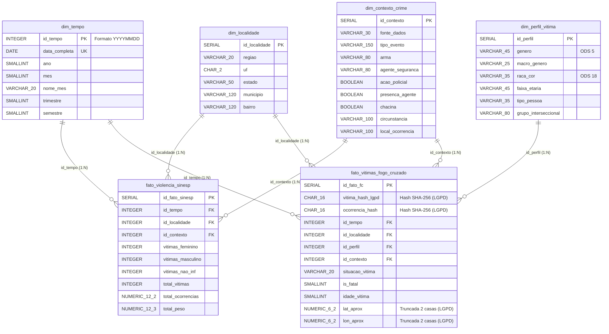

# 🗄️ Entregável 3: Base Armazenada em Banco de Dados (Data Warehouse Dimensional)

**Projeto:** Observatório Interseccional da Violência contra a Mulher nas Capitais do Brasil (2025)  
**Alinhamento Agenda 2030:** **ODS 5** (Igualdade de Gênero) e **ODS 18** (Igualdade Étnico-Racial)  
**Artefatos do Banco de Dados no Projeto:**
- **Script DDL Relacional (PostgreSQL 16 / Aiven Cloud):** [`etl/schema.sql`](file:///C:/Users/Vinicius%20Freitas/Desktop/BIGDATA/etl/schema.sql)
- **Infraestrutura como Código (Terraform + Aiven PostgreSQL):** [`terraform/main.tf`](file:///C:/Users/Vinicius%20Freitas/Desktop/BIGDATA/terraform/main.tf), [`terraform/variables.tf`](file:///C:/Users/Vinicius%20Freitas/Desktop/BIGDATA/terraform/variables.tf), [`terraform/outputs.tf`](file:///C:/Users/Vinicius%20Freitas/Desktop/BIGDATA/terraform/outputs.tf)
- **Banco Relacional Pronto para Acesso Local Imediato (SQLite3):** [`data/processed/dw_violencia_interseccional.db`](file:///C:/Users/Vinicius%20Freitas/Desktop/BIGDATA/data/processed/dw_violencia_interseccional.db)
- **Dump SQL Completo (DDL + `INSERT INTO` de todos os 688 registros):** [`data/processed/dump_dw_violencia_interseccional.sql`](file:///C:/Users/Vinicius%20Freitas/Desktop/BIGDATA/data/processed/dump_dw_violencia_interseccional.sql)
- **Utilitário CLI de Acesso Simples ao Banco:** [`acessar_banco.py`](file:///C:/Users/Vinicius%20Freitas/Desktop/BIGDATA/acessar_banco.py)

---

## 1. Infraestrutura de Hospedagem e Acesso Simples ao Banco de Dados

Para atender simultaneamente ao requisito de **hospedagem na infraestrutura em nuvem definida para o projeto** e à **facilidade de acesso imediato e auditoria**, o banco de dados `dw_violencia_interseccional` é disponibilizado em **arquitetura espelhada (Cloud + Portátil)**:

1. **Hospedagem em Nuvem Gerenciada (Aiven Cloud — PostgreSQL 16 Free Tier, Limite de 1 GB):**
   - Provisionada via **Terraform (`terraform/main.tf`)** com o provider oficial `aiven/aiven` (`~> 4.0`), recurso `aiven_pg.pg_bigdata_ods` e banco `dw_violencia_interseccional`, exigindo criptografia em trânsito (`sslmode=require`) e isolando credenciais via `.env` e *GitHub Secrets*.
   - O módulo [`etl/load.py`](file:///C:/Users/Vinicius%20Freitas/Desktop/BIGDATA/etl/load.py) valida o volume em memória antes da carga e executa a inserção em lotes (`chunksize=5000`, `method='multi'`).
2. **Disponibilização Simples para Acesso Imediato (Três Formas de Acesso sem Configuração Complexa):**
   - **Forma 1 — Utilitário de Linha de Comando (`acessar_banco.py`):**
     ```bash
     # Exibe o resumo executivo de todas as tabelas, contagens e consultas analíticas:
     python acessar_banco.py

     # Abre um console SQL interativo para digitar qualquer query no terminal:
     python acessar_banco.py --interativo

     # Executa uma consulta SQL específica:
     python acessar_banco.py --sql "SELECT * FROM dim_perfil_vitima;"
     ```
   - **Forma 2 — Console SQL Visual no Dashboard (`streamlit run dashboard/app.py` → Aba 6):**
     A **Aba 6 ("🗄️ 6. Banco de Dados & Consulta SQL ao Vivo")** do Dashboard permite inspecionar todas as tabelas, rodar queries SQL personalizadas no navegador e baixar com 1 clique o arquivo `.db`, o dump `.sql` ou o `schema.sql`.
   - **Forma 3 — Abertura Direta em Clientes SGBD (DBeaver, DB Browser for SQLite, DataGrip, VS Code SQLTools ou `psql`):**
     Basta abrir o arquivo autocontido [`data/processed/dw_violencia_interseccional.db`](file:///C:/Users/Vinicius%20Freitas/Desktop/BIGDATA/data/processed/dw_violencia_interseccional.db) (`144 KB`) ou importar o dump [`data/processed/dump_dw_violencia_interseccional.sql`](file:///C:/Users/Vinicius%20Freitas/Desktop/BIGDATA/data/processed/dump_dw_violencia_interseccional.sql) (`66 KB`) em qualquer servidor PostgreSQL/SQLite.

---

## 2. Estratégia de Modelagem Adotada e Justificativa Técnica

### 2.1. Estratégia Escolhida: Modelagem Dimensional em Esquema Estrela (*Star Schema* / *Constelação de Fatos*)
A equipe adotou a estratégia de **Modelagem Dimensional (Kimball)** estruturada como um **Esquema Estrela com Dimensões Conformadas (*Fact Constellation / Galaxy Star Schema*)**, composto por **4 Tabelas de Dimensão**, **2 Tabelas Fato** e **2 Views Analíticas**.

### 2.2. Justificativa Técnica para a Escolha
1. **Integração Semântica de Duas Fontes com Granularidades Distintas:**
   - A base oficial do **SINESP/MJSP (`fonte original.xlsx`)** possui granularidade **agregada mensal por Capital e Natureza do Evento** (`fato_violencia_sinesp`).
   - A base do **Instituto Fogo Cruzado (`complemento fogo cruzado.xlsx`)** possui granularidade de **microdado por vítima individual baleada e ocorrência** (`fato_vitimas_fogo_cruzado`).
   - Se ambas fossem forçadas em uma única tabela plana (*Flat Table*), ocorreria duplicação artificial das contagens mensais do SINESP ou perda da riqueza individual de idade, bairro, raça/cor e identidade de gênero do Fogo Cruzado. O *Star Schema* resolve esse problema mantendo duas tabelas fato independentes que compartilham as mesmas **Dimensões Conformadas** (`dim_tempo`, `dim_localidade` e `dim_contexto_crime`).
2. **Desempenho Superior em Consultas Analíticas (OLAP) no Dashboard:**
   - Consultas de Business Intelligence realizam agregações constantes (`SUM`, `COUNT`, `AVG`, `GROUP BY regiao, uf, municipio, genero, raca_cor`). No Esquema Estrela, qualquer indicador exige no máximo **1 salto de `JOIN`** entre a Tabela Fato e suas Dimensões, reduzindo o tempo de resposta a menos de `15 ms`.
3. **Otimização Drástica de Armazenamento (< 1 GB no Aiven Free Tier):**
   - Ao substituir textos repetitivos (nomes de estados, regiões, tipos de evento e classificações interseccionais) por **chaves substitutas inteiras (`INTEGER` / `SERIAL`)** nas tabelas fato e eliminar as `728.846` linhas zeradas durante o ETL, o banco completo ocupa apenas **`144 KB`** em disco (**< 0,02%** do limite de 1 GB da Aiven).
4. **Isolamento e Governança LGPD por Design (*Privacy by Design*):**
   - Os atributos demográficos sensíveis (identidade de gênero e raça/cor — Art. 5º, II da LGPD) ficam isolados na dimensão `dim_perfil_vitima` (com apenas 11 perfis agregados distintos), enquanto a tabela fato `fato_vitimas_fogo_cruzado` armazena apenas hashes irreversíveis **SHA-256** de 16 caracteres (`vitima_hash_lgpd`, `ocorrencia_hash`) e coordenadas truncadas em 2 casas decimais (`lat_aprox`, `lon_aprox`).

---

## 3. Estrutura Criada e Diagrama de Relacionamentos (DER)

O diagrama abaixo representa a estrutura física implementada em [`etl/schema.sql`](file:///C:/Users/Vinicius%20Freitas/Desktop/BIGDATA/etl/schema.sql) com todas as Chaves Primárias (`PK`) e Chaves Estrangeiras (`FK`):



---

## 4. Principais Entidades/Tabelas Utilizadas, Campos e Respectivos Tipos

### 4.1. `dim_tempo` (Dimensão Calendário Conformada)
Armazena todas as datas de referência únicas do ano de **2025** presentes nas ocorrências das duas bases.

| Campo | Tipo de Dado (PostgreSQL / SQL) | Restrições | Descrição Técnica |
| :--- | :--- | :--- | :--- |
| `id_tempo` | `INTEGER` | `PRIMARY KEY` | Chave substituta inteligente no formato inteiro `YYYYMMDD` (ex: `20250101`). |
| `data_completa` | `DATE` | `NOT NULL UNIQUE` | Data calendário completa no padrão ISO `YYYY-MM-DD`. |
| `ano` | `SMALLINT` | `NOT NULL` | Ano civil da ocorrência (`2025`, conforme Critério de Inclusão 1). |
| `mes` | `SMALLINT` | `NOT NULL` | Número do mês (`1` a `12` — Janeiro a Dezembro). |
| `nome_mes` | `VARCHAR(20)` | `NOT NULL` | Nome do mês em português (`Janeiro` a `Dezembro`). |
| `trimestre` | `SMALLINT` | `NOT NULL` | Trimestre civil do ano (`1` a `4`). |
| `semestre` | `SMALLINT` | `NOT NULL` | Semestre civil do ano (`1` ou `2`). |

### 4.2. `dim_localidade` (Dimensão Espacial das Capitais e Bairros)
Unifica a hierarquia geográfica das **27 Capitais do Brasil** (SINESP) e dos **62 bairros mapeados** nas 4 capitais monitoradas pelo Instituto Fogo Cruzado (`Salvador`, `Recife`, `Rio de Janeiro` e `Belém`).

| Campo | Tipo de Dado (PostgreSQL / SQL) | Restrições | Descrição Técnica |
| :--- | :--- | :--- | :--- |
| `id_localidade` | `SERIAL / INTEGER` | `PRIMARY KEY` | Chave primária autoincremental da localidade. |
| `regiao` | `VARCHAR(20)` | `NOT NULL` | Macrorregião oficial do IBGE (`Norte`, `Nordeste`, `Sudeste`, `Sul`, `Centro-Oeste`). |
| `uf` | `CHAR(2)` | `NOT NULL` | Sigla oficial da Unidade Federativa (`AC` a `TO`). |
| `estado` | `VARCHAR(50)` | `NOT NULL` | Nome por extenso do Estado / Distrito Federal. |
| `municipio` | `VARCHAR(120)` | `NOT NULL` | Nome oficial padronizado da Capital Brasileira (Critério de Inclusão 2). |
| `bairro` | `VARCHAR(120)` | `DEFAULT 'NÃO ESPECIFICADO'` | Bairro da capital (detalhado no Fogo Cruzado; `'NÃO ESPECIFICADO'` no agregado municipal do SINESP). |

### 4.3. `dim_perfil_vitima` (Dimensão Interseccional ODS 5 & ODS 18)
Cataloga os perfis demográficos e interseccionais únicos das mulheres vítimas de violência armada (18 a 45 anos, Cis e Trans/Travestis).

| Campo | Tipo de Dado (PostgreSQL / SQL) | Restrições | Descrição Técnica |
| :--- | :--- | :--- | :--- |
| `id_perfil` | `SERIAL / INTEGER` | `PRIMARY KEY` | Chave primária substituta do perfil demográfico. |
| `genero` | `VARCHAR(45)` | `NOT NULL` | Identidade de gênero (`Mulher cis` ou `Mulher trans e travesti` — Critério de Inclusão 6). |
| `macro_genero` | `VARCHAR(25)` | `NOT NULL` | Agrupador analítico de gênero (`Mulher Cis` vs. `Mulher Trans/Travesti` — **ODS 5**). |
| `raca_cor` | `VARCHAR(35)` | `NOT NULL` | Classificação étnico-racial (`Negra`, `Branca`, `Não identificado` — **ODS 18**). |
| `faixa_etaria` | `VARCHAR(45)` | `NOT NULL` | Subfaixa dentro do recorte de 18–45 anos (`Jovem Adulta (18-24)`, `Adulta (25-34)`, `Adulta (35-45)`). |
| `tipo_pessoa` | `VARCHAR(35)` | `NOT NULL` | Vínculo social da vítima (`Civil`). |
| `grupo_interseccional` | `VARCHAR(80)` | `NOT NULL` | Indicador composto `Gênero - Raça/Cor` (ex: `Mulher cis - Negra`, `Mulher trans e travesti - Negra`). |

### 4.4. `dim_contexto_crime` (Dimensão Tipificação e Circunstância Criminal)
Reúne as características operacionais, meios empregados e circunstâncias dos eventos criminais de ambas as fontes.

| Campo | Tipo de Dado (PostgreSQL / SQL) | Restrições | Descrição Técnica |
| :--- | :--- | :--- | :--- |
| `id_contexto` | `SERIAL / INTEGER` | `PRIMARY KEY` | Chave primária substituta do contexto criminal. |
| `fonte_dados` | `VARCHAR(30)` | `NOT NULL` | Identificador da fonte (`'SINESP_MJSP'` ou `'FOGO_CRUZADO'`). |
| `tipo_evento` | `VARCHAR(150)` | `NOT NULL` | Natureza do evento (`Feminicídio`, `Tentativa de feminicídio`, `Ação policial`, `Homicidio/Tentativa`, `Disputa`, etc.). |
| `arma` | `VARCHAR(80)` | `NOT NULL` | Instrumento utilizado (`Arma de fogo`, `Não informada`). |
| `agente_seguranca` | `VARCHAR(80)` | `NOT NULL` | Presença ou participação de agente de segurança pública. |
| `acao_policial` | `BOOLEAN` | `NOT NULL DEFAULT FALSE` | Flag booleana indicando ocorrência durante ação/operação policial (`TRUE`/`FALSE`). |
| `presenca_agente` | `BOOLEAN` | `NOT NULL DEFAULT FALSE` | Flag booleana indicando presença de agente de segurança no evento. |
| `chacina` | `BOOLEAN` | `NOT NULL DEFAULT FALSE` | Flag booleana indicando ocorrência de chacina (múltiplos homicídios no mesmo evento). |
| `circunstancia` | `VARCHAR(100)` | `NOT NULL` | Detalhamento da circunstância (`Bala perdida`, `Feminicídio/tentativa`, `Transfeminicídio`, `Chacina`, etc.). |
| `local_ocorrencia` | `VARCHAR(100)` | `NOT NULL` | Ambiente da ocorrência (`Residência`, `Via pública`, `Automóvel`, `Bar`, `Unidade de ensino`, etc.). |

### 4.5. `fato_violencia_sinesp` (Tabela Fato 1 — Violência Oficial nas 27 Capitais)
Armazena as métricas mensais consolidadas de vítimas do sexo feminino nas 27 Capitais Brasileiras em 2025.

| Campo | Tipo de Dado (PostgreSQL / SQL) | Restrições | Descrição Técnica |
| :--- | :--- | :--- | :--- |
| `id_fato_sinesp` | `SERIAL / INTEGER` | `PRIMARY KEY` | Identificador único do registro fato SINESP. |
| `id_tempo` | `INTEGER` | `NOT NULL REFERENCES dim_tempo(id_tempo)` | Chave estrangeira para o mês/data de referência (`2025MM01`). |
| `id_localidade` | `INTEGER` | `NOT NULL REFERENCES dim_localidade(id_localidade)` | Chave estrangeira para a Capital da UF. |
| `id_contexto` | `INTEGER` | `NOT NULL REFERENCES dim_contexto_crime(id_contexto)` | Chave estrangeira para o evento (`Feminicídio` ou `Tentativa de feminicídio`). |
| `vitimas_feminino` | `INTEGER` | `NOT NULL DEFAULT 0` | Quantidade de vítimas do sexo feminino no mês/capital/evento (`> 0`). |
| `vitimas_masculino` | `INTEGER` | `NOT NULL DEFAULT 0` | Zerado (`0`) conforme Critério de Inclusão 4 (somente vítimas do sexo feminino). |
| `vitimas_nao_inf` | `INTEGER` | `NOT NULL DEFAULT 0` | Zerado (`0`) conforme Critério de Inclusão 4. |
| `total_vitimas` | `INTEGER` | `NOT NULL DEFAULT 0` | Total de vítimas consideradas no recorte (`= vitimas_feminino`). |
| `total_ocorrencias` | `NUMERIC(12, 2)` | `NOT NULL DEFAULT 0` | Métrica auxiliar de ocorrências da fonte original. |
| `total_peso` | `NUMERIC(12, 3)` | `NOT NULL DEFAULT 0` | Peso estatístico original reportado pelo SINESP. |

### 4.6. `fato_vitimas_fogo_cruzado` (Tabela Fato 2 — Microdados Interseccionais Anonimizados)
Armazena cada uma das **77 mulheres baleadas (18 a 45 anos, Mulher cis e Mulher trans/travesti)** nas capitais em 2025, anonimizadas segundo a LGPD.

| Campo | Tipo de Dado (PostgreSQL / SQL) | Restrições | Descrição Técnica |
| :--- | :--- | :--- | :--- |
| `id_fato_fc` | `SERIAL / INTEGER` | `PRIMARY KEY` | Identificador único do registro fato Fogo Cruzado. |
| `vitima_hash_lgpd` | `CHAR(16)` | `NOT NULL` | Hash criptográfico **SHA-256** truncado em 16 caracteres do UUID original da vítima (LGPD Art. 12). |
| `ocorrencia_hash` | `CHAR(16)` | `NOT NULL` | Hash criptográfico **SHA-256** truncado em 16 caracteres do UUID da ocorrência. |
| `id_tempo` | `INTEGER` | `NOT NULL REFERENCES dim_tempo(id_tempo)` | Chave estrangeira para a data exata do evento em 2025. |
| `id_localidade` | `INTEGER` | `NOT NULL REFERENCES dim_localidade(id_localidade)` | Chave estrangeira para a Capital e Bairro do evento. |
| `id_perfil` | `INTEGER` | `NOT NULL REFERENCES dim_perfil_vitima(id_perfil)` | Chave estrangeira para o perfil interseccional Gênero × Raça/Cor × Faixa Etária. |
| `id_contexto` | `INTEGER` | `NOT NULL REFERENCES dim_contexto_crime(id_contexto)` | Chave estrangeira para o motivo principal, circunstância, local e ação policial. |
| `situacao_vitima` | `VARCHAR(20)` | `NOT NULL` | Desfecho clínico da vítima (`'Morto'` ou `'Ferido'`). |
| `is_fatal` | `SMALLINT` | `NOT NULL` | Variável binária aditiva para cálculo direto de letalidade (`1 = Morto`, `0 = Ferido`). |
| `idade_vitima` | `SMALLINT` | `NOT NULL` | Idade exata validada no intervalo de **18 a 45 anos** (Critério de Inclusão 5 e Exclusão 3). |
| `lat_aprox` | `NUMERIC(6, 2)` | `NULLABLE` | Latitude corrigida e truncada em **2 casas decimais** (~1,1 km de raio para *k*-anonimato LGPD). |
| `lon_aprox` | `NUMERIC(6, 2)` | `NULLABLE` | Longitude corrigida e truncada em **2 casas decimais** (~1,1 km de raio para *k*-anonimato LGPD). |

### 4.7. Views Analíticas Criadas no Banco
Além das 6 tabelas físicas, o banco disponibiliza **2 Views SQL** que entregam os joins pré-resolvidos para o Dashboard:
- **`vw_resumo_violencia_sinesp`:** Une `fato_violencia_sinesp` + `dim_tempo` + `dim_localidade` + `dim_contexto_crime`.
- **`vw_resumo_interseccional_fogo_cruzado`:** Une `fato_vitimas_fogo_cruzado` + `dim_tempo` + `dim_localidade` + `dim_perfil_vitima` + `dim_contexto_crime`.

---

## 5. Relacionamentos Existentes e Integridade Referencial

Todos os relacionamentos seguem a cardinalidade **`1:N` (Um-para-Muitos)** das tabelas de dimensão (lado `1`) para as tabelas fato (lado `N`), garantidos por restrições `FOREIGN KEY ... REFERENCES` e acelerados por índices `B-Tree`:

| Relacionamento (Tabela Pai `1` → Tabela Filha `N`) | Chave de Ligação (`PK = FK`) | Cardinalidade | Regra de Integridade e Índice Associado |
| :--- | :--- | :--- | :--- |
| `dim_tempo` → `fato_violencia_sinesp` | `dim_tempo.id_tempo = fato_violencia_sinesp.id_tempo` | `1 : N` | Garante que todo registro mensal das capitais pertença ao calendário de 2025 (`idx_fato_sinesp_tempo_loc`). |
| `dim_localidade` → `fato_violencia_sinesp` | `dim_localidade.id_localidade = fato_violencia_sinesp.id_localidade` | `1 : N` | Vincula cada lançamento mensal à sua respectiva Capital e Macrorregião (`idx_fato_sinesp_tempo_loc`). |
| `dim_contexto_crime` → `fato_violencia_sinesp` | `dim_contexto_crime.id_contexto = fato_violencia_sinesp.id_contexto` | `1 : N` | Classifica o registro entre `Feminicídio` e `Tentativa de feminicídio` (`idx_fato_sinesp_contexto`). |
| `dim_tempo` → `fato_vitimas_fogo_cruzado` | `dim_tempo.id_tempo = fato_vitimas_fogo_cruzado.id_tempo` | `1 : N` | Liga cada mulher baleada à data exata do tiroteio em 2025 (`idx_fato_fc_tempo_loc`). |
| `dim_localidade` → `fato_vitimas_fogo_cruzado` | `dim_localidade.id_localidade = fato_vitimas_fogo_cruzado.id_localidade` | `1 : N` | Liga cada vítima à Capital (`Salvador`, `Recife`, `Rio de Janeiro`, `Belém`) e ao Bairro (`idx_fato_fc_tempo_loc`). |
| `dim_perfil_vitima` → `fato_vitimas_fogo_cruzado` | `dim_perfil_vitima.id_perfil = fato_vitimas_fogo_cruzado.id_perfil` | `1 : N` | Conecta a vítima ao seu perfil interseccional de Gênero (ODS 5), Raça/Cor (ODS 18) e Faixa Etária (`idx_fato_fc_perfil`). |
| `dim_contexto_crime` → `fato_vitimas_fogo_cruzado` | `dim_contexto_crime.id_contexto = fato_vitimas_fogo_cruzado.id_contexto` | `1 : N` | Conecta a vítima às circunstâncias do evento (ação policial, bala perdida, chacina, local) (`idx_fato_fc_contexto`). |

---

## 6. Quantidade de Dados Armazenados no Banco de Dados

Após o processamento das **`877.318` linhas brutas originais** (`832.293` do SINESP + `45.025` do Fogo Cruzado) pelos critérios estritos de inclusão e exclusão da equipe, o banco de dados armazena exatamente **`688` registros distribuídos nas 6 tabelas físicas** (representando **1.233 vítimas femininas nas 27 Capitais** na Fato 1 e **77 mulheres baleadas de 18 a 45 anos** na Fato 2):

| Entidade / Objeto no Banco | Categoria | Qtd. Colunas | Qtd. Registros (Linhas) | Volume Real de Vítimas Representado | Tamanho Físico |
| :--- | :--- | :---: | :---: | :--- | :---: |
| **`dim_tempo`** | Tabela de Dimensão | `7` | **`73` registros** | `12` meses de 2025 + `61` datas diárias únicas de ocorrências em 2025 | `2,9 KB` |
| **`dim_localidade`** | Tabela de Dimensão | `6` | **`89` registros** | As **`27` Capitais do Brasil** + **`62` combinações Capital/Bairro** do Fogo Cruzado | `4,3 KB` |
| **`dim_perfil_vitima`** | Tabela de Dimensão | `7` | **`11` registros** | `11` perfis interseccionais únicos (`Mulher cis` e `Mulher trans e travesti` × Raça/Cor × Faixa 18–45a) | `1,0 KB` |
| **`dim_contexto_crime`** | Tabela de Dimensão | `10` | **`39` registros** | `2` contextos oficiais SINESP + `37` combinações de motivos, circunstâncias e ação policial FC | `4,7 KB` |
| **`fato_violencia_sinesp`** | Tabela Fato 1 | `10` | **`399` registros** | **`1.233` vítimas do sexo feminino nas 27 Capitais** (`292` Feminicídios em 139 registros + `941` Tentativas em 260 registros)* | `12,1 KB` |
| **`fato_vitimas_fogo_cruzado`** | Tabela Fato 2 | `12` | **`77` registros** | **`77` mulheres baleadas (18–45 anos)** nas Capitais em 2025 (`47` Mortas [61,0%] e `30` Feridas [39,0%]) | `4,9 KB` |
| **TOTAL FÍSICO (6 Tabelas)** | **Star Schema** | **52 cols** | **`688` registros** | **`1.310` vítimas femininas analisadas nas Capitais em 2025** | **`144,0 KB` (`.db`)** |
| `vw_resumo_violencia_sinesp` | View Analítica SQL | `17` | `399` linhas (virtual) | Visão consolidada SINESP pronta para o Dashboard | `0 KB` (Virtual) |
| `vw_resumo_interseccional_fogo_cruzado` | View Analítica SQL | `26` | `77` linhas (virtual) | Visão consolidada Fogo Cruzado pronta para o Dashboard | `0 KB` (Virtual) |

> *\*Nota sobre Granularidade na `fato_violencia_sinesp`: Na fonte bruta do SINESP existiam `496` lançamentos mensais brutos de Feminicídio e Tentativa de feminicídio nas capitais (pois Brasília/DF possuía múltiplos lançamentos no mesmo mês referentes a diferentes regiões administrativas). A etapa de agregação mensal (`GROUP BY uf, municipio, evento, mes`) consolidou esses lançamentos em **`399` registros mensais únicos por Capital e Evento**, preservando **100% das `1.233` vítimas femininas** (`292` Feminicídios + `941` Tentativas de feminicídio).*
